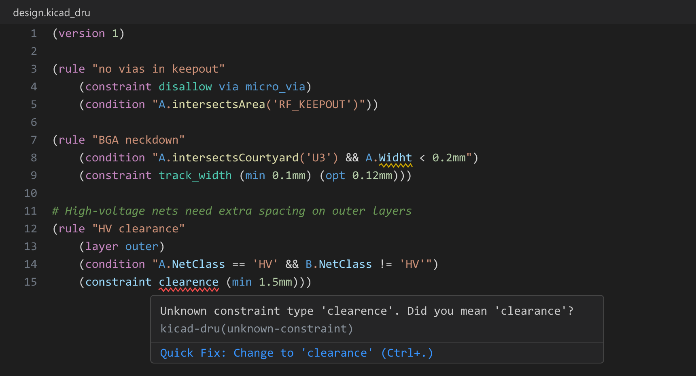

<p align="center">
  
</p>

# KiCad Custom Design Rules — VS Code extension

Syntax highlighting, completion, hover help, diagnostics with quick fixes,
an outline and a formatter for KiCad **Custom Design Rule** files
(`.kicad_dru`) in Visual Studio Code — desktop, vscode.dev and github.dev.



<sub>Rendered from the extension's own grammar and diagnostics engine.</sub>

KiCad ships a single-line textbox in *Board Setup → Custom Rules* and a
*Check Rule Syntax* button. That works for one-liners. For real rule sets
you want a real editor — multi-cursor, search, and colour that distinguishes
`condition` operators from `A.NetClass` accessors from layer names from
string literals. This extension adds that for `.kicad_dru` specifically.

## Features

- **Syntax highlighting** scoped to `.kicad_dru`. Keywords (`version`,
  `rule`, `constraint`, `condition`, `layer`, `severity`, `disallow`),
  constraint types (`clearance`, `hole_clearance`, `track_width`,
  `length`, `assertion`, …), token-expression accessors (`A.NetClass`,
  `B.intersectsArea`, …), operators, layer names, severities, comments,
  strings, and numbers with units are all coloured distinctly.
- **Snippets** for the common rule shapes: starter `rule` block, clearance
  by netclass, disallow, length matching, via and track sizing,
  hole-to-hole, assertion. Type the prefix in a paren context, accept,
  tab through.
- **IntelliSense completion**. Inside `(condition "…")` /
  `(constraint assertion "…")` strings: a receiver and `.` (`A.`, `B.`,
  `AB.`) gets its properties, an identifier boundary gets receivers and
  functions; inside `A.Type == '…'` the item types, and inside
  `A.Layer == '…'` / `existsOnLayer('…')` the layer names. While writing the
  rule structure: after `(constraint ` you get constraint types, after
  `(layer ` layer names (both `F.SilkS` and `F.Silkscreen` styles), after
  `(severity ` severities, after `(constraint disallow ` the categories. Each
  item shows its type/units or argument shape and a short doc.
- **Hover help**. Hover a constraint type, property, function, layer,
  severity, or disallow category to see what it is, its argument/type, and a
  one-line description.
- **Diagnostics with quick fixes**. Definite mistakes are underlined as you
  type — a misspelled constraint type, keyword, layer, property or function
  ("did you mean `clearance`?"), a unit on a unitless constraint, a second
  constraint of the same type in one rule, a missing `(version 1)`. Press
  <kbd>Ctrl</kbd>+<kbd>.</kbd> to apply the fix.
- **Outline and Go to Symbol**. Every rule appears in the Outline panel and
  breadcrumbs with its clauses; <kbd>Ctrl</kbd>+<kbd>Shift</kbd>+<kbd>O</kbd>
  jumps to a rule by name.
- **Format Document** (<kbd>Shift</kbd>+<kbd>Alt</kbd>+<kbd>F</kbd>). One
  clause per line under each rule, consistent indentation, comments kept in
  place. String contents are never touched, and a file with a syntax error is
  left as-is.
- **Regions**. Wrap related rules in `# region Power` … `# endregion` to
  fold them as a block; the label shows as a section header in the minimap.
- **Editor niceties**: `#` line comment toggling, paren matching, folding
  on each multi-line `( … )` block, auto-closing pairs.
- **Works in the browser**: vscode.dev and github.dev, not just desktop.

Completion, hover and diagnostics are backed by a single `data/api.json`
audited against the KiCad 10.0.0 source.

## What this extension does *not* do

- It is not a full validator. Diagnostics flag only what KiCad definitely
  rejects as errors (unbalanced parentheses, a missing `(version 1)`
  header, unknown constraint types or keywords, bad `severity` /
  `disallow` / `zone_connection` values, units on unitless constraints,
  duplicate constraints or `(layer …)` clauses in one rule), and likely
  mistakes as warnings (an `A.`/`B.` property or function the catalogue
  doesn't know, a deprecated alias, a misspelled layer name, an `A.Type`
  comparison that can never match, a KiCad 11 / master-only token). When
  unsure it stays silent — renamed layers, for instance, are never flagged.
  KiCad's own *Check Rule Syntax* button remains the source of truth for
  whether a rule is valid. Tune or disable with the `kicad-dru.diagnostics`
  setting (`all` / `errors` / `off`).
- It does not parse `.kicad_pcb`, `.kicad_sch`, `.kicad_sym`, or any other
  KiCad file. Those have other extensions (`DanielMeza.kicad-syntax-
  highlighter` covers most of them; `oaslananka.kicadstudio` covers KiCad
  workflows end-to-end). This extension intentionally stays focused on
  `.kicad_dru` so that DRU support is first-class instead of incidental.
- It does not check rule semantics (value ranges, whether a constraint makes
  sense on a layer, cross-rule interactions). That is KiCad's job.

## Installation

From the VS Code Marketplace:

```
ext install cimos.kicad-dru
```

Or search for **"KiCad Custom Design Rules"** in the Extensions view. Users of
VSCodium, Cursor and other Open VSX-based editors can install it from
[Open VSX](https://open-vsx.org/extension/cimos/kicad-dru).

A `.vsix` is also attached to each GitHub release if you prefer manual
installation:

```
code --install-extension vscode-kicad-dru-<version>.vsix
```

## Use with KiCad's External Tools menu

KiCad ≥ 7 supports launching an external editor on a file via
*Preferences → Configure Paths → External Tools*. Pointing it at VS Code
gives you a one-click round trip from the KiCad PCB editor to this
extension's editor view. Save the file in VS Code, switch back to KiCad,
and re-run *Check Rule Syntax*.

## Contributing

Pull requests are welcome — especially for grammar gaps you hit on a real
rule file. Please attach a minimal `.kicad_dru` snippet that demonstrates
the issue.

```
npm ci
npm test                  # grammar snapshots + assertion cases + unit tests
npm run test:integration  # launches a real VS Code with only this extension
```

All language logic lives in plain, `vscode`-free modules under `src/`
(completion, hover, diagnostics, symbols, format, folding), driven by
`data/api.json`; `src/extension.ts` only adapts them to VS Code. CI runs both
suites on every pull request.

Issues: <https://github.com/Cimos/vscode-kicad-dru/issues>

## License

[MIT](LICENSE.md).
